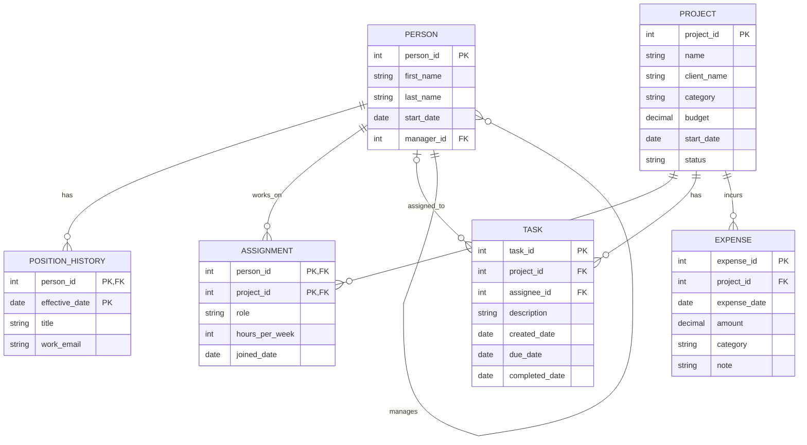

# Database Project

## 1. The Scenario

A · BabsonAI Labs. BabsonAI Labs is a startup founded by Babson students that builds AI tools for small businesses. It has about 25 people and tracks its work in spreadsheets and chat threads. The founders want to see who works on what, where the money goes, and who is overloaded.

## 2. The ERD

## 3. What One Row Means

- **PERSON:** one employee. A row is a single person at BabsonAI Labs, with their name, start date and who they report to. There are about 25 rows.
- **POSITION_HISTORY:** one period in a person's career at the company. A row says "starting on this date, this person held this title and used this work email." A person who has changed title has several rows, and the latest one is their current title and email.
- **PROJECT:** one piece of work the company does. A row is a single project, with its client (if any), category, budget and status.
- **ASSIGNMENT:** one person working on one project. A row says "this person is on this project, in this role, committing this many hours a week since this date." It is the link between people and projects, so a person on three projects has three rows.
- **TASK:** one unit of work inside a project. A row is a single task, with who it's assigned to (or no one yet), when it was created and due, and when it was finished (empty until then).
- **EXPENSE:** one money spent on a project. A row is a single charge, with its date, amount, category and a short note.

## 4. Design Choices
